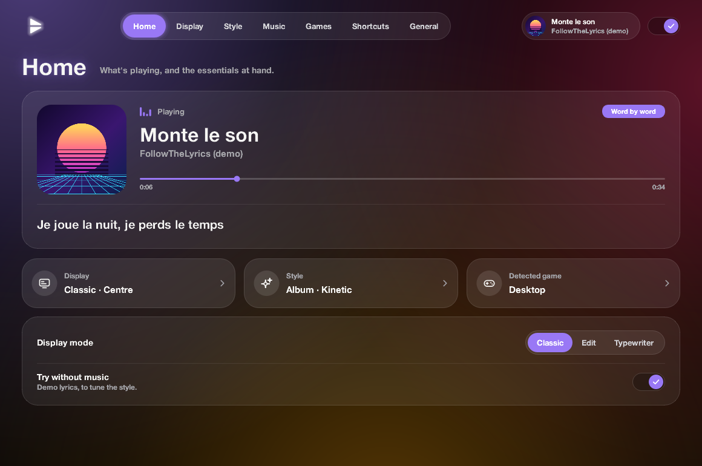

<p align="center"></p>
<p align="center"><b>Your music's lyrics, right over your games.</b><br>
Word by word, in time, in the colours of the album cover. Windows 10 and 11, and Linux.</p>
<p align="center">
<a href="https://github.com/War3l/FollowTheLyrics/releases/latest/download/FollowTheLyrics.exe"><b>⬇ Download for Windows</b></a>
 · <a href="https://github.com/War3l/FollowTheLyrics/releases/latest/download/FollowTheLyrics-linux"><b>⬇ Download for Linux</b></a>
 · <a href="https://war3l.github.io/FollowTheLyrics/?lang=en">Website</a>
</p>
<p align="center"><a href="README.md">Français</a> · <b>English</b></p>




Works with Spotify, YouTube Music, Deezer, Apple Music… without signing in to any account.

> The app is in English by default, and also available in French, Spanish and Chinese (General page).

## Install
1. Download **[FollowTheLyrics.exe](https://github.com/War3l/FollowTheLyrics/releases/latest/download/FollowTheLyrics.exe)**: a single file.
2. Double-click it. If Windows says "Windows protected your PC" (the file is not signed):
   **More info → Run anyway**.
3. Start your music, and play in **borderless windowed** mode.

On first launch, a welcome screen explains the basics and offers to start with Windows and to
add a desktop shortcut.

### On Linux
1. Download **[FollowTheLyrics-linux](https://github.com/War3l/FollowTheLyrics/releases/latest/download/FollowTheLyrics-linux)**,
   make it executable (`chmod +x FollowTheLyrics-linux`) and run it.
2. The current track comes from **MPRIS** (Spotify, Firefox, Chrome, VLC, mpv with `mpris`…),
   the beat from **PulseAudio or PipeWire**.
3. Global shortcuts and game detection go through **X11**. On Wayland, the app opens through
   XWayland: shortcuts work when an XWayland window is in the foreground (which is the case for
   most Steam and Proton games), and a Proton game is recognised by the name of its `.exe`, so
   the Windows profiles apply as they are.
4. Autostart uses `~/.config/autostart`, settings live in `~/.config/FollowTheLyrics`.

Closing the panel does not quit the app: the lyrics keep going. The icon near the clock reopens
the panel (left click); right click → **Quitter** to stop.

### Updates
The app checks from time to time whether a newer version exists on GitHub. If so, a banner shows
in the panel: one click on **Mettre à jour** downloads the new version, replaces the program in
place (same file, same shortcuts, same settings) and restarts the app.

### The .exe in practice
- Settings, game profiles and cache are stored in `%APPDATA%\FollowTheLyrics`: the `.exe` can be
  moved or replaced without losing anything.
- The `.exe` is not signed: Windows may say "Windows protected your PC". Just click
  **More info → Run anyway**.

## The panel
- **Now playing**: cover, title, artist, progress, **WORD BY WORD** / **LINE** badge, sung line and translation.
- **Display mode**:
  - **Classic**: lines scroll at the top left, centre or right.
  - **Edit**: each line pops up at a different spot in the upper half.
  - **Typewriter**: letters are typed as they are sung, with a cursor.
- **Look**: album colours or bright white, animation (kinetic, karaoke, simple), size, font (search + preview).
- **Options**: French translation, pulse on the beat, cover card, particles, demo mode, start with Windows (quietly, near the clock).
- **Huge title**: when the singer says the track's title, it shows very large (at most once every 20 s). Out of game: almost the whole screen. In game: in a free area of the upper half. Setting: Always / Out of game / Never.
- **Music sources**: tick the apps to follow (Spotify, browser…). In a browser, only music sites are followed (YouTube Music, Spotify, SoundCloud…). Media longer than 20 minutes is ignored.
- **Sync and games**: lyrics offset, detected game, forbidden zones.

## Shortcuts (work in game)
All can be changed in the panel, **Raccourcis** page: click a shortcut then press the new combination. Defaults:

| Keys | Action |
|---|---|
| Ctrl+Alt+L | Show / hide |
| Ctrl+Alt+M | Change mode |
| Ctrl+Alt+T | Album colours / white |
| Ctrl+Alt+S | Change animation |
| Ctrl+Alt+Z | Show the game's forbidden zones (5 s) |
| Ctrl+Alt+E | Capture the game for the zone editor |
| Ctrl+Alt+↑ / ↓ | Lyrics earlier / later (0.2 s) |

## What happens on screen
- Each line disappears 3 s after being sung; only the previous one stays, faded.
- **Pulse**: the text swells slightly on the kick drum (the app listens to the PC's sound, nothing is recorded). With several audio outputs (GoXLR, Voicemeeter…), it finds the one carrying the music by itself.
- **Chorus**: bigger, brighter, stronger entrance.
- **Backing vocals** "(yeah)" set apart, small and italic; **singer names** in small above the line.
- **Held words** (WORD BY WORD): they grow, glow and shake, with particles.
- **Cover card** for 4-5 s at the start of each track.

## Games and forbidden zones
- The app looks at which program is in the foreground, without touching the game (no anti-cheat trouble).
- **League of Legends** has its profile (centre, abilities, minimap, score, chat, announcements, right edge). In Classic mode, the **Left** position has the most room in LoL.
- **Cyberpunk 2077** has its profile (health, calls, minimap, objective, crosshair, dialogues, subtitles, weapons, notifications). In Classic mode, the **Centre** position falls in the free space at the top.
- **World of Warcraft** (retail and Classic) has its profile (portraits, group, minimap and buffs, quests, messages, character, action bars, chat, bags). In Classic mode, the **Centre** position falls in the free space at the top.
- The overlay goes back in front of the game as soon as the game takes the foreground, and checks every 0.5 s.
- If the game is in **exclusive fullscreen**, Windows shows nothing on top: the app detects it, warns you (notification + panel) and says where to change the mode in the game.
- Other fullscreen game or video: cautious profile. Desktop: the whole screen is free.
- **Zone editor**: in game, **Ctrl+Alt+E** takes a capture (without the lyrics). Back in
  FollowTheLyrics, you draw with the mouse the places to avoid, name them and save.
  It also works for a game without a profile: it is created on save. Panel → **Dessiner les zones**.

## Under the hood
- Running **run.bat** again automatically replaces the version already open.
- Found lyrics are kept in the `cache` folder: instant on later listens, even offline.
- After a network drop, the search is retried by itself (10 s, 30 s, 1 min…).
- The screen is only redrawn when something moves.

## Good to know
- The game must be in **borderless windowed** mode (exclusive fullscreen lets nothing show on top).
- Lyrics: NetEase Cloud Music (timing of each word), otherwise LRCLIB (timing per line). When word timing is missing, the app asks LiriQo as a fallback, a third-party service that gathers other sources (can be turned off in the Musique page). Translation: Google Translate. These services are unofficial and may change.

## Development
```
python -m venv .venv
.venv\Scripts\python -m pip install -e ".[dev]"
.venv\Scripts\python -m followthelyrics          (--demo for test lyrics)
```
`run.bat` does the same without a terminal (`run.bat --demo` for the demo).

On Linux: `.venv/bin/python -m pip install -e ".[dev]"` then `.venv/bin/python -m followthelyrics`.

Checks, also run by CI on every pull request, on Windows and on Linux:
```
ruff check src tests tools
ruff format --check src tests tools
mypy
mypy --platform linux
pytest
```

### Building the program
- **On a pull request**, CI builds `FollowTheLyrics.exe` and the Linux binary and attaches them
  to the result (*Checks* tab, artifacts `FollowTheLyrics-exe` and `FollowTheLyrics-linux`):
  enough to test the PR without installing anything.
- **Locally**: `pip install -e ".[build]"` then `python tools/build.py` produces
  `dist\FollowTheLyrics.exe` on Windows and `dist/FollowTheLyrics` on Linux (2 to 4 minutes).
  The Linux binary is built on Ubuntu 22.04 so it runs on newer distributions.

### Publishing a version
On GitHub: **Actions → Release → Run workflow**, then the version number (for example `1.2.0`)
and a sentence of release notes. The workflow checks that the version is newer, runs mypy and the
tests on Windows and Linux, builds both programs, pushes the version commit and its tag, then
creates the release with `FollowTheLyrics.exe` and `FollowTheLyrics-linux`. If a step fails before
the build ends, nothing is published.
The website's download buttons and the automatic update always point to the latest release.

- The website lives in `docs/` (GitHub Pages).

## Code layout
The code lives in `src/followthelyrics/`, organised by responsibility.
The details (role of each module, data flow, dependency rules) are in
[ARCHITECTURE.md](ARCHITECTURE.md) (in French).

| Folder | Role |
|---|---|
| `app.py` | assembles the app: overlay, panel, tray icon, timers |
| `config/` | settings (`config.json`) and game profiles with their forbidden zones |
| `lyrics/` | line model, LRC and YRC parsing, lyrics sources, cache, analysis (choruses, strong words) |
| `desktop/` | everything that touches the system: contracts (`ports.py`), Windows backend, Linux backend, Qt-only backend for macOS |
| `playback/` | current track, browser site recognition, beat detection, worker thread |
| `overlay/` | the lyrics window and its rendering: animations, colours, effects, easter eggs |
| `ui/` | control panel, animated widgets, welcome screen, zone editor |
| `system/` | autostart, installation, updates, keyboard shortcuts, on top of the `desktop/` ports |
| `tests/` | pytest tests, with no particular system or network |
| `tools/` | building the program, website video and visuals, small diagnostic scripts |
| `.github/workflows/` | `ci.yml` (lint, types, tests, test builds) and `release.yml` (publishing) |
