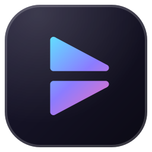

<p align="center"></p>
<h1 align="center">FollowTheLyrics</h1>
<p align="center"><b>Les paroles de ta musique, par-dessus tes jeux.</b><br>
Mot à mot, en rythme, aux couleurs de la pochette. Windows 10 et 11.</p>
<p align="center">
<a href="https://github.com/War3l/FollowTheLyrics/releases/latest/download/FollowTheLyrics.exe"><b>⬇ Télécharger la dernière version</b></a>
 · <a href="https://war3l.github.io/FollowTheLyrics/">Site de présentation</a>
</p>


Marche avec Spotify, YouTube Music, Deezer, Apple Music… sans connexion à un compte.

## Installer
1. Télécharge **[FollowTheLyrics.exe](https://github.com/War3l/FollowTheLyrics/releases/latest/download/FollowTheLyrics.exe)** : un seul fichier, rien à installer.
2. Double-clique dessus. Si Windows affiche « Windows a protégé votre ordinateur » (le fichier n'est pas signé) :
   **Informations complémentaires → Exécuter quand même**.
3. Lance ta musique, et joue en **fenêtré sans bordure**.

Au premier lancement, un écran de bienvenue explique l'essentiel et propose le démarrage avec
Windows et un raccourci sur le bureau.

Fermer le panneau ne quitte pas l'appli : les paroles continuent. L'icône près de l'heure rouvre
le panneau (clic gauche) ; clic droit → **Quitter** pour arrêter.

### Mises à jour
L'appli regarde de temps en temps s'il existe une version plus récente sur GitHub. Si oui, un bandeau
apparaît dans le panneau : un clic sur **Mettre à jour** télécharge la nouvelle version, remplace le
`.exe` sur place (même fichier, mêmes raccourcis, mêmes réglages) et relance l'appli.

### Le .exe en pratique
- Réglages, profils de jeux et cache sont rangés dans `%APPDATA%\FollowTheLyrics` : le `.exe` peut
  être déplacé ou remplacé sans rien perdre.
- Le `.exe` n'est pas signé : chez un ami, Windows peut afficher « Windows a protégé votre
  ordinateur ». Il suffit de cliquer **Informations complémentaires → Exécuter quand même**.
- **Construire.bat** refabrique le `.exe` après une modification du code (2 à 4 minutes).

## Le panneau
- **En cours** : pochette, titre, artiste, progression, badge **MOT À MOT** / **LIGNE**, ligne chantée et traduction.
- **Mode d'affichage** :
  - **Classique** : les lignes défilent en haut à gauche, au centre ou à droite.
  - **Edit** : chaque ligne surgit à un endroit différent de la moitié haute.
  - **Machine à écrire** : les lettres s'écrivent au fil du chant, avec un curseur.
- **Apparence** : couleurs de l'album ou blanc lumineux, animation (cinétique, karaoké, simple), taille, police (recherche + aperçu).
- **Options** : traduction française, pulsation sur le beat, carte de la pochette, particules, mode démo, lancement avec Windows (discret, près de l'heure).
- **Titre en géant** : quand le chanteur dit le titre du morceau, il s'affiche en très grand (au plus une fois toutes les 20 s). Hors jeu : presque tout l'écran. En jeu : dans un espace libre de la moitié haute. Réglable : Toujours / Hors jeu / Jamais.
- **Sources de musique** : coche les applis à écouter (Spotify, navigateur…). Les médias de plus de 20 minutes sont ignorés.
- **Synchro et jeux** : décalage des paroles, jeu détecté, zones interdites.

## Raccourcis (marchent en jeu)
Tous modifiables dans le panneau, page **Raccourcis** : clique sur un raccourci puis appuie sur la nouvelle combinaison. Ceux d'origine :

| Touches | Action |
|---|---|
| Ctrl+Alt+L | Afficher / masquer |
| Ctrl+Alt+M | Changer de mode |
| Ctrl+Alt+T | Couleurs album / blanc |
| Ctrl+Alt+S | Changer d'animation |
| Ctrl+Alt+Z | Voir les zones interdites du jeu (5 s) |
| Ctrl+Alt+E | Capturer le jeu pour l'éditeur de zones |
| Ctrl+Alt+↑ / ↓ | Paroles plus tôt / plus tard (0,2 s) |

## Ce qui se passe à l'écran
- Chaque ligne disparaît 3 s après avoir été chantée ; seule la précédente reste, en transparence.
- **Pulsation** : le texte grossit légèrement sur la grosse caisse (le logiciel écoute le son du PC, rien n'est enregistré). Avec plusieurs sorties audio (GoXLR, Voicemeeter…), il cherche tout seul celle où passe la musique.
- **Refrain** : plus grand, plus brillant, entrée plus marquée.
- **Chœurs** « (yeah) » à part, en petit et en italique ; **noms des chanteurs** en petit au-dessus de la ligne.
- **Mots tenus** (MOT À MOT) : ils grossissent, brillent, tremblent, avec des particules.
- **Carte pochette** 4-5 s au début de chaque morceau.

## Jeux et zones interdites
- Le logiciel regarde quel programme est au premier plan, sans toucher au jeu (pas de souci d'anti-cheat).
- **League of Legends** a son profil (centre, sorts, minimap, score, chat, annonces, bord droit). En mode Classique, la position **Gauche** est celle qui a le plus de place dans LoL.
- **Cyberpunk 2077** a son profil (vie, appels, minimap, objectif, viseur, dialogues, sous-titres, armes, notifications). En mode Classique, la position **Centre** tombe dans l'espace libre en haut.
- **World of Warcraft** (retail et Classic) a son profil (portraits, groupe, minimap et buffs, quêtes, messages, personnage, barres d'action, chat, sacs). En mode Classique, la position **Centre** tombe dans l'espace libre en haut.
- L'overlay se remet devant le jeu dès que le jeu passe au premier plan, et vérifie toutes les 0,5 s.
- Si le jeu est en **plein écran exclusif**, Windows n'affiche rien par-dessus : le logiciel le détecte, prévient (notification + panneau) et indique où changer le mode dans le jeu.
- Autre jeu ou vidéo en plein écran : profil prudent. Bureau : tout l'écran est libre.
- **Éditeur de zones** : en jeu, **Ctrl+Alt+E** prend une capture (sans les paroles). De retour sur
  FollowTheLyrics, tu dessines à la souris les endroits à éviter, tu les nommes, tu enregistres.
  Ça marche aussi pour un jeu sans profil : il est créé à l'enregistrement. Panneau → **Dessiner les zones**.

## Sous le capot
- Relancer **Lancer.bat** remplace automatiquement la version déjà ouverte.
- Les paroles trouvées sont gardées dans le dossier `cache` : instantanées aux écoutes suivantes, même hors ligne.
- Après une coupure réseau, la recherche est retentée toute seule (10 s, 30 s, 1 min…).
- L'écran n'est redessiné que quand quelque chose bouge.

## À savoir
- Le jeu doit être en **fenêtré sans bordure** (le plein écran exclusif ne laisse rien s'afficher par-dessus).
- Paroles : NetEase Cloud Music (timing de chaque mot), sinon LRCLIB (timing par ligne). Traduction : Google Traduction. Ces deux services ne sont pas officiels et peuvent changer.

## Développer
```
python -m venv .venv
.venv\Scripts\python -m pip install -r requirements.txt
.venv\Scripts\python overlay.py          (ou Lancer.bat ; Demo.bat pour des paroles de test)
```
- **Construire.bat** fabrique `dist/FollowTheLyrics.exe` (2 à 4 minutes).
- **Publier.bat** publie une mise à jour : il demande le numéro de version, construit le `.exe`,
  envoie le code sur GitHub et crée la version téléchargeable. Le bouton « Télécharger » du site
  pointe toujours vers la dernière version. Il faut [GitHub CLI](https://cli.github.com) connecté (`gh auth login`).
- Le site de présentation est dans `docs/` (GitHub Pages).

## Fichiers
- `overlay.py` : la fenêtre des paroles, l'appli, les raccourcis.
- `panel.py` : le panneau de contrôle (un menu, une page par sujet). `widgets.py` : ses briques animées.
- `hotkeys.py` : les raccourcis clavier modifiables.
- `easter.py` : les easter eggs (certains morceaux déclenchent un spectacle à part).
- `install.py` : installation sur le PC (menu Démarrer, « Applications installées », désinstallation).
- `video_demo.py` : fabrique la vidéo de démo du site à partir du vrai rendu de l'appli.
- `visuels_site.py` : fabrique les images des cartes du site, elles aussi tirées du vrai rendu.
- `updater.py` : la mise à jour automatique. `zone_editor.py` : l'éditeur de zones.
- `bootstrap.py` : le démarrage blindé du `.exe`.
- `welcome.py` : l'écran de bienvenue. `build.py` : la fabrication du `.exe` et de son icône.
- `settings.py` : les réglages (sauvés dans `config.json`).
- `media.py`, `lyrics.py`, `games.py`, `audio.py` : musique en cours, paroles, jeux, beats.
