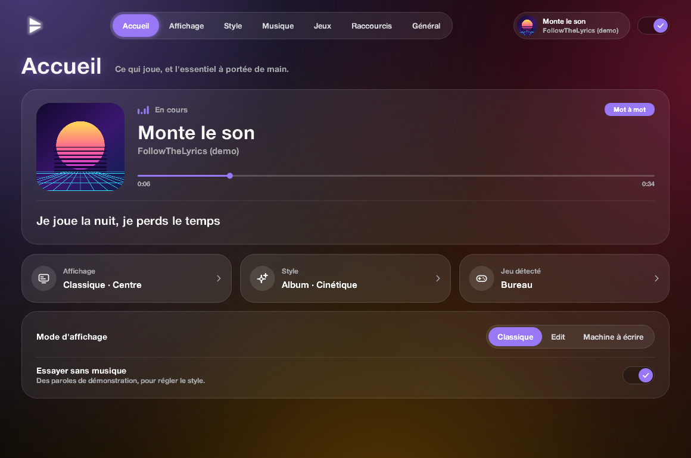

<p align="center"></p>
<p align="center"><b>Les paroles de ta musique, par-dessus tes jeux.</b><br>
Mot à mot, en rythme, aux couleurs de la pochette. Windows 10 et 11, et Linux.</p>
<p align="center">
<a href="https://github.com/War3l/FollowTheLyrics/releases/latest/download/FollowTheLyrics.exe"><b>⬇ Télécharger pour Windows</b></a>
 · <a href="https://github.com/War3l/FollowTheLyrics/releases/latest/download/FollowTheLyrics-linux"><b>⬇ Télécharger pour Linux</b></a>
 · <a href="https://war3l.github.io/FollowTheLyrics/">Site de présentation</a>
</p>
<p align="center"><b>Français</b> · <a href="README.en.md">English</a></p>




Marche avec Spotify, YouTube Music, Deezer, Apple Music… sans connexion à un compte.

L'appli existe en anglais (par défaut), français, espagnol et chinois : le choix est dans la page Général.

## Installer
1. Télécharge **[FollowTheLyrics.exe](https://github.com/War3l/FollowTheLyrics/releases/latest/download/FollowTheLyrics.exe)** : un seul fichier, rien à installer.
2. Double-clique dessus. Si Windows affiche « Windows a protégé votre ordinateur » (le fichier n'est pas signé) :
   **Informations complémentaires → Exécuter quand même**.
3. Lance ta musique, et joue en **fenêtré sans bordure**.

Au premier lancement, un écran de bienvenue explique l'essentiel et propose le démarrage avec
Windows et un raccourci sur le bureau.

### Sur Linux
1. Télécharge **[FollowTheLyrics-linux](https://github.com/War3l/FollowTheLyrics/releases/latest/download/FollowTheLyrics-linux)**,
   rends-le exécutable (`chmod +x FollowTheLyrics-linux`) et lance-le.
2. Le morceau en cours vient de **MPRIS** (Spotify, Firefox, Chrome, VLC, mpv avec `mpris`…),
   la pulsation du son de **PulseAudio ou PipeWire**.
3. Les raccourcis globaux et la détection du jeu passent par **X11**. Sous Wayland, l'appli
   s'ouvre via XWayland : les raccourcis marchent quand une fenêtre XWayland est au premier plan
   (c'est le cas de la plupart des jeux Steam et Proton), et un jeu sous Proton est reconnu par
   le nom de son `.exe`, donc les profils Windows s'appliquent tels quels.
4. Le démarrage auto passe par `~/.config/autostart`, les réglages sont dans
   `~/.config/FollowTheLyrics`.

Fermer le panneau ne quitte pas l'appli : les paroles continuent. L'icône près de l'heure rouvre
le panneau (clic gauche) ; clic droit → **Quitter** pour arrêter.

### Mises à jour
L'appli regarde de temps en temps s'il existe une version plus récente sur GitHub. Si oui, un bandeau
apparaît dans le panneau : un clic sur **Mettre à jour** télécharge la nouvelle version, remplace le
`.exe` sur place (même fichier, mêmes raccourcis, mêmes réglages) et relance l'appli.

### Le .exe en pratique
- Réglages, profils de jeux et cache sont rangés dans `%APPDATA%\FollowTheLyrics` : le `.exe` peut
  être déplacé ou remplacé sans rien perdre.
- Le `.exe` n'est pas signé : chez un ami, Windows peut afficher « Windows a protégé votre
  ordinateur ». Il suffit de cliquer **Informations complémentaires → Exécuter quand même**.

## Le panneau
- **En cours** : pochette, titre, artiste, progression, badge **MOT À MOT** / **LIGNE**, ligne chantée et traduction.
- **Mode d'affichage** :
  - **Classique** : les lignes défilent en haut à gauche, au centre ou à droite.
  - **Edit** : chaque ligne surgit à un endroit différent de la moitié haute.
  - **Machine à écrire** : les lettres s'écrivent au fil du chant, avec un curseur.
- **Apparence** : couleurs de l'album ou blanc lumineux, animation (cinétique, karaoké, simple), taille, police (recherche + aperçu).
- **Options** : traduction française, pulsation sur le beat, carte de la pochette, particules, mode démo, lancement avec Windows (discret, près de l'heure).
- **Titre en géant** : quand le chanteur dit le titre du morceau, il s'affiche en très grand (au plus une fois toutes les 20 s). Hors jeu : presque tout l'écran. En jeu : dans un espace libre de la moitié haute. Réglable : Toujours / Hors jeu / Jamais.
- **Sources de musique** : coche les applis à écouter (Spotify, navigateur…). Les médias de plus de 20 minutes sont ignorés.
- **Synchro et jeux** : décalage des paroles, jeu détecté, zones interdites.

## Raccourcis (marchent en jeu)
Tous modifiables dans le panneau, page **Raccourcis** : clique sur un raccourci puis appuie sur la nouvelle combinaison. Ceux d'origine :

| Touches | Action |
|---|---|
| Ctrl+Alt+L | Afficher / masquer |
| Ctrl+Alt+M | Changer de mode |
| Ctrl+Alt+T | Couleurs album / blanc |
| Ctrl+Alt+S | Changer d'animation |
| Ctrl+Alt+Z | Voir les zones interdites du jeu (5 s) |
| Ctrl+Alt+E | Capturer le jeu pour l'éditeur de zones |
| Ctrl+Alt+↑ / ↓ | Paroles plus tôt / plus tard (0,2 s) |

## Ce qui se passe à l'écran
- Chaque ligne disparaît 3 s après avoir été chantée ; seule la précédente reste, en transparence.
- **Pulsation** : le texte grossit légèrement sur la grosse caisse (le logiciel écoute le son du PC, rien n'est enregistré). Avec plusieurs sorties audio (GoXLR, Voicemeeter…), il cherche tout seul celle où passe la musique.
- **Refrain** : plus grand, plus brillant, entrée plus marquée.
- **Chœurs** « (yeah) » à part, en petit et en italique ; **noms des chanteurs** en petit au-dessus de la ligne.
- **Mots tenus** (MOT À MOT) : ils grossissent, brillent, tremblent, avec des particules.
- **Carte pochette** 4-5 s au début de chaque morceau.

## Jeux et zones interdites
- Le logiciel regarde quel programme est au premier plan, sans toucher au jeu (pas de souci d'anti-cheat).
- **League of Legends** a son profil (centre, sorts, minimap, score, chat, annonces, bord droit). En mode Classique, la position **Gauche** est celle qui a le plus de place dans LoL.
- **Cyberpunk 2077** a son profil (vie, appels, minimap, objectif, viseur, dialogues, sous-titres, armes, notifications). En mode Classique, la position **Centre** tombe dans l'espace libre en haut.
- **World of Warcraft** (retail et Classic) a son profil (portraits, groupe, minimap et buffs, quêtes, messages, personnage, barres d'action, chat, sacs). En mode Classique, la position **Centre** tombe dans l'espace libre en haut.
- L'overlay se remet devant le jeu dès que le jeu passe au premier plan, et vérifie toutes les 0,5 s.
- Si le jeu est en **plein écran exclusif**, Windows n'affiche rien par-dessus : le logiciel le détecte, prévient (notification + panneau) et indique où changer le mode dans le jeu.
- Autre jeu ou vidéo en plein écran : profil prudent. Bureau : tout l'écran est libre.
- **Éditeur de zones** : en jeu, **Ctrl+Alt+E** prend une capture (sans les paroles). De retour sur
  FollowTheLyrics, tu dessines à la souris les endroits à éviter, tu les nommes, tu enregistres.
  Ça marche aussi pour un jeu sans profil : il est créé à l'enregistrement. Panneau → **Dessiner les zones**.

## Sous le capot
- Relancer **run.bat** remplace automatiquement la version déjà ouverte.
- Les paroles trouvées sont gardées dans le dossier `cache` : instantanées aux écoutes suivantes, même hors ligne.
- Après une coupure réseau, la recherche est retentée toute seule (10 s, 30 s, 1 min…).
- L'écran n'est redessiné que quand quelque chose bouge.

## À savoir
- Le jeu doit être en **fenêtré sans bordure** (le plein écran exclusif ne laisse rien s'afficher par-dessus).
- Paroles : NetEase Cloud Music (timing de chaque mot), sinon LRCLIB (timing par ligne). Quand il manque le mot à mot, l'appli demande en secours à LiriQo, un service tiers qui regroupe d'autres sources (désactivable dans la page Musique). Traduction : Google Traduction. Ces services ne sont pas officiels et peuvent changer.

## Développer
```
python -m venv .venv
.venv\Scripts\python -m pip install -e ".[dev]"
.venv\Scripts\python -m followthelyrics          (--demo pour des paroles de test)
```
`run.bat` fait la même chose sans terminal (`run.bat --demo` pour la démo).

Sous Linux : `.venv/bin/python -m pip install -e ".[dev]"` puis `.venv/bin/python -m followthelyrics`.

Vérifications, lancées aussi par la CI à chaque pull request, sous Windows et sous Linux :
```
ruff check src tests tools
ruff format --check src tests tools
mypy
mypy --platform linux
pytest
```

### Construire le programme
- **Sur une pull request**, la CI construit `FollowTheLyrics.exe` et le binaire Linux et les joint
  au résultat (onglet *Checks*, artefacts `FollowTheLyrics-exe` et `FollowTheLyrics-linux`) : de
  quoi tester la PR sans rien installer.
- **En local** : `pip install -e ".[build]"` puis `python tools/build.py` produit
  `dist\FollowTheLyrics.exe` sous Windows et `dist/FollowTheLyrics` sous Linux (2 à 4 minutes).
  Le binaire Linux est construit sur Ubuntu 22.04 pour tourner sur les distributions plus récentes.

### Publier une version
Sur GitHub : **Actions → Release → Run workflow**, puis le numéro de version (par exemple `1.2.0`)
et une phrase de nouveautés. Le workflow vérifie que la version est plus récente, lance mypy et les
tests sous Windows et sous Linux, construit les deux programmes, pousse le commit de version et
son tag, puis crée la release avec `FollowTheLyrics.exe` et `FollowTheLyrics-linux`. Si une étape échoue avant la fin de la construction, rien n'est publié.
Le bouton « Télécharger » du site et la mise à jour automatique pointent toujours vers la dernière release.

- Le site de présentation est dans `docs/` (GitHub Pages).

## Organisation du code
Le code vit dans `src/followthelyrics/`, rangé par responsabilité.
Le détail (rôle de chaque module, flux de données, règles de dépendance) est dans
[ARCHITECTURE.md](ARCHITECTURE.md).

| Dossier | Rôle |
|---|---|
| `app.py` | assemble l'appli : overlay, panneau, icône de la barre des tâches, minuteries |
| `config/` | réglages (`config.json`) et profils de jeux avec leurs zones interdites |
| `lyrics/` | modèle d'une ligne, lecture des formats LRC et YRC, sources de paroles, cache, analyse (refrains, mots forts) |
| `desktop/` | tout ce qui touche au système : contrats (`ports.py`), backend Windows, backend Linux, backend Qt seul pour macOS |
| `playback/` | morceau en cours, reconnaissance du site du navigateur, détection des beats, fil de travail |
| `overlay/` | la fenêtre des paroles et son rendu : animations, couleurs, effets, easter eggs |
| `ui/` | panneau de contrôle, briques animées, écran de bienvenue, éditeur de zones |
| `system/` | démarrage auto, installation, mises à jour, raccourcis clavier, au-dessus des ports de `desktop/` |
| `tests/` | tests pytest, sans système particulier ni réseau |
| `tools/` | fabrication du `.exe`, vidéo et visuels du site, petits scripts de diagnostic |
| `.github/workflows/` | `ci.yml` (lint, types, tests, `.exe` de test) et `release.yml` (publication) |
